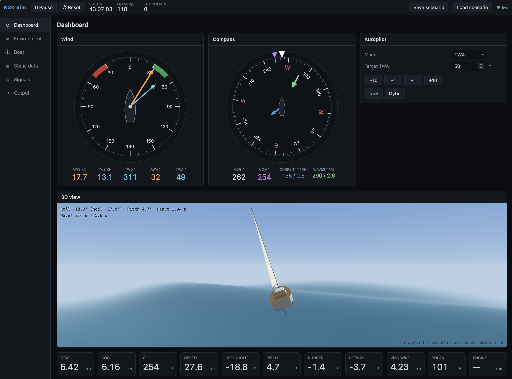

# n2k-sim

A lean NMEA 2000 simulator of a 40 ft cruising yacht. It streams realistic, mutually consistent N2K
data in **Yacht Devices RAW** format over **UDP (port 2002)** and **TCP (port 2223)** — the same
format and ports as a Hat Labs SH-wg or YDWG-02 gateway — and has a browser UI to watch and steer it.

## Quick start

```bash
uv venv .venv && uv pip install -p .venv -e ".[dev]"
.venv/bin/python -m n2k_sim
```

Open http://127.0.0.1:8080/. Point a client (e.g. NMEA Dashboard: *NMEA2000 YD RAW*) at this
machine's IP, TCP port 2223, or listen on UDP port 2002.

Options: `--scenario file.json`, `--udp-host 192.168.1.255` (subnet broadcast or unicast, e.g.
`127.0.0.1` for an emulator), `--udp-port`, `--tcp-port`, `--seed`, `--ui-host 0.0.0.0` (expose the
UI on the LAN — it has no login).

## What it simulates



Three tiers (details in [docs/spec/simulation.md](docs/spec/simulation.md)):

1. **Environment** — wind over ground with oscillation, slow shifts, lulls and gusts; current;
   waves (direction, height, period); seabed depth.
2. **Boat** — autopilot (hold heading, hold TWA, motor), STW from a polar file, heel from a lookup
   table, leeway `K·heel/STW²`, pitch/roll from waves, rudder, rate of turn, position.
3. **Sensors** — noise-free GPS (full GNSS data), fluxgate compass (magnetic), masthead wind,
   paddle-wheel log, depth sounder, rudder, engine, tanks, batteries, weather station.

An instrument processor then calculates true wind, ground wind, set & drift (with leeway
correction), VMG, polar performance and dew point. All values can be overridden; overrides change
only what is transmitted.

## Output

~95 frames/s from one gateway source address (0x23) — 29 PGN schedules incl. 127250/127251/127257,
128259/128267/128275, 129025/129026/129029/129539/129540, 130306 (apparent, true, ground),
127488/127489, 127505, 127508, 1303xx environment. See [docs/spec/n2k-output.md](docs/spec/n2k-output.md).
Encoding follows the NMEA 2000 specification ([docs/spec/pgn-reference.md](docs/spec/pgn-reference.md)).

## Development

```bash
.venv/bin/python -m pytest
```

Layout: `environment/` (tier 1) · `boat/` (tier 2) · `sensors/` (tier 3) · `calc/` (processor) ·
`signals/` (catalogue) · `n2k/` (encoders, fast packet, gateway) · `formats/` (YD RAW) ·
`transport/` (UDP, TCP, recorder) · `web/` (API + static UI). Specification: [docs/spec](docs/spec/README.md).

Keep it away from a real boat network: if a gateway on the same LAN has YD RAW *receive* enabled
(e.g. SH-wg "Receive from WiFi"), it would put the simulated data onto the real bus, where it
competes with real instruments.
